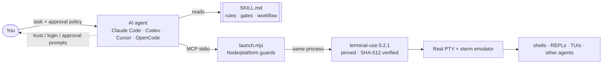

<div align="center">


# gentle-terminal

**Approval-first terminal control for AI coding agents.**

Let Claude Code, Codex, Cursor, OpenCode and any MCP client drive *real* interactive shells, CLIs and TUIs (and even supervise other coding agents) without auto-approving prompts, mistaking timeouts for success, or killing work in progress.

[](https://github.com/reyrodman/gentle-terminal/actions/workflows/ci.yml)
[](LICENSE)
[](https://nodejs.org)
[](https://modelcontextprotocol.io)
[](SKILL.md)
[](#supported-platforms)

[Quick start](#quick-start) ·
[Connect your client](#connect-your-mcp-client) ·
[Examples](#usage-examples) ·
[How it works](#how-it-works) ·
[Safety model](#safety-model) ·
[FAQ](#faq)

</div>

---

## Why gentle-terminal?

Most agent shell tools run one command and hand back its output. That breaks the moment a program is **interactive**: `vim`, `htop`, a Python REPL, `git rebase -i`, an installer asking questions, an SSH login, or another AI agent like Codex CLI waiting for approval.

[terminal-use](https://github.com/computer-agent-labs/terminal-use) solves the mechanics: a real PTY rendered by a real terminal emulator, exposed over MCP. **gentle-terminal adds the judgment** an agent needs to use that power responsibly:

| Without a policy, agents tend to... | gentle-terminal teaches them to... |
|---|---|
| Treat a wait timeout as "done" or "failed" | Re-read the screen and classify the state: working, needs input, idle or exited |
| Press Enter again or resubmit when nothing seems to happen | Type **once**; re-waiting is never resubmitting |
| Pick "Always allow" on trust and approval prompts | Surface the exact prompt to you; one-time approval only when your policy covers it |
| Trust another agent's "I'm done" | Inspect the artifact and run the check independently |
| Kill a slow process to make progress | Keep supervising in bounded waits and report long stalls to you |
| Leave orphaned shells behind | Close owned idle sessions and report anything uncertain |

## Features

- 🖥️ **Real terminals, not command runners.** Full PTY with colors, cursor movement and alternate screen, readable as text or PNG screenshots (powered by terminal-use).
- 🛡️ **Approval-first Agent Skill.** A compact [`SKILL.md`](SKILL.md) with hard rules, decision gates and an output contract that any skill-aware agent can load.
- 🤖 **Supervise other coding agents.** A [state-based workflow](references/workflow.md) with observed working/idle/prompt signals for Codex CLI, OpenCode and Antigravity CLI.
- 📌 **Pinned and verifiable.** Runtime locked to `terminal-use@0.2.1` with SHA-512 integrity, installed with `--ignore-scripts`; a test fails if the pin drifts.
- 🧳 **Portable launcher.** One `node launch.mjs` entry point that works from any cwd and from paths with spaces, forwarding stdio, arguments and exit codes in the same process.
- 🔌 **Works with every stdio MCP client.** Ready-to-copy configs for Claude Code, Codex CLI, Cursor, VS Code, OpenCode and Claude Desktop.
- ✅ **Tested on Linux, macOS and Windows.** Deterministic MCP smoke test (no model, no network calls) plus a `node:test` suite in CI.
- 🪶 **Zero global footprint.** No global install, no PATH or profile edits, no automatic client registration.

## Quick start

**Requirements:** Node.js **22.12 or newer** and npm, on Windows, Linux or macOS (x64 or arm64).

```bash
git clone https://github.com/reyrodman/gentle-terminal.git
cd gentle-terminal
npm run setup      # installs the pinned runtime into ./runtime (no lifecycle scripts)
npm run verify     # prints 0.2.1, runs the test suite and the MCP smoke test
```

Expected tail of `npm run verify`:

```text
PASS: persistent variable, typed text, Enter, read, exit 7, destroy, disconnect; server exit=0 stderr=""; owned shell gone.
```

> [!TIP]
> Clone straight into your agent's skills folder so the skill and the MCP server live in one place, for example `~/.codex/skills/gentle-terminal`, `~/.claude/skills/gentle-terminal` or `~/.cursor/skills/gentle-terminal`. Check your client's documentation for its exact skill discovery path.

## Connect your MCP client

gentle-terminal is a standard **stdio** MCP server: command `node`, argument the absolute path to `launch.mjs`.

<details open>
<summary><b>Claude Code</b></summary>

```bash
claude mcp add gentle-terminal --scope user -- node /absolute/path/to/gentle-terminal/launch.mjs
```
</details>

<details>
<summary><b>Codex CLI</b></summary>

```bash
codex mcp add gentle-terminal -- node /absolute/path/to/gentle-terminal/launch.mjs
```

Or merge [`examples/codex/config.toml`](examples/codex/config.toml) into `~/.codex/config.toml`:

```toml
[mcp_servers.gentle-terminal]
command = "node"
args = ["/absolute/path/to/gentle-terminal/launch.mjs", "--cwd", "/approved/workspace"]
```
</details>

<details>
<summary><b>Cursor</b> / <b>Claude Desktop</b> / other <code>mcpServers</code> clients</summary>

```json
{
  "mcpServers": {
    "gentle-terminal": {
      "command": "node",
      "args": ["/absolute/path/to/gentle-terminal/launch.mjs", "--cwd", "/approved/workspace"]
    }
  }
}
```

Files: [`examples/cursor/mcp.json`](examples/cursor/mcp.json), [`examples/claude-desktop/claude_desktop_config.json`](examples/claude-desktop/claude_desktop_config.json).
</details>

<details>
<summary><b>VS Code</b></summary>

See [`examples/vscode/mcp.json`](examples/vscode/mcp.json) (place it in `.vscode/mcp.json`).
</details>

<details>
<summary><b>OpenCode</b></summary>

See [`examples/opencode/opencode.json`](examples/opencode/opencode.json). OpenCode expects a command **array**, not a shell string.
</details>

On Windows, use an absolute Windows path (`C:/tools/gentle-terminal/launch.mjs` or escaped backslashes in JSON). More details and caveats: [`references/clients.md`](references/clients.md).

> [!IMPORTANT]
> Adding the MCP server gives the agent the **tools**. Loading [`SKILL.md`](SKILL.md) (through your client's skill discovery, or by asking the agent to read it) gives it the **policy**. Use both.

## Usage examples

Ask your agent in plain language. A few prompts that show what the skill changes:

```text
Open a terminal in this project, set APP_ENV=test, run the test suite and tell me the real exit code.
Keep the session open so I can run more commands with the same environment.
```

```text
Start Codex CLI in /approved/workspace and ask it to add a unit test for parseConfig.
If it asks to trust the folder or approve a command, stop and show me the exact prompt.
When it says it's done, verify the test file exists and run it yourself before telling me.
```

```text
Run `git rebase -i HEAD~3`, show me the todo list as a screenshot, and stop there.
I'll decide what to squash.
```

What a well-behaved supervised session looks like (tool calls from the agent's side):

```text
terminal_create  { cwd: "/approved/workspace" }             -> Created session 1
terminal_type    { sessionId: 1, text: "codex\n" }           -> trust screen detected
  ⤷ human decision: "Do you trust the contents of this project?" shown to the user, agent waits
terminal_type    { sessionId: 1, text: "add a unit test for parseConfig" }   (typed once)
terminal_press   { sessionId: 1, key: "Enter" }
terminal_wait    { sessionId: 1, pattern: "Worked for|Allow|\\(y/n\\)", timeoutMs: 60000 }
  ⤷ timed out -> terminal_read -> "esc to interrupt" still visible -> state: working -> wait again
terminal_wait    { ... }                                     -> "Worked for 2m 14s" -> state: idle
  ⤷ agent reads the new test file and runs it in a separate command session: exit 0
terminal_type    { sessionId: 1, text: "/quit\n" }           -> exit code 0 observed
terminal_destroy { sessionId: 1 }
```

More prompts, including REPLs, full-screen editors and long builds: [`examples/prompts.md`](examples/prompts.md).

## How it works



1. **`launch.mjs`** checks Node (>= 22.12) and platform, then imports the official `terminal-use` binary **in the same process**, so arguments, stdio, signals and exit codes behave exactly as upstream. No child wrapper, no extra engine.
2. **`runtime/`** holds a lockfile that pins `terminal-use@0.2.1` by registry integrity. Each machine installs its own platform-specific prebuilt binaries; `node_modules` is never shipped.
3. **`SKILL.md`** and **`references/workflow.md`** encode the operating policy: classify the screen after every wait, stop at human decisions, verify artifacts before follow-ups, exit naturally and clean up owned sessions.

### Tools exposed (from terminal-use)

| Tool | Purpose |
|---|---|
| `terminal_create` | Start an interactive shell, or a single program with `command` (exact exit status) |
| `terminal_type` / `terminal_press` / `terminal_batch` | Type text, press keys and combinations, or send several inputs at once |
| `terminal_wait` | Wait for a command to finish, a regex to appear, or output to go quiet |
| `terminal_read` / `terminal_screenshot` | Read the screen as text, or render it as a PNG |
| `terminal_click` / `terminal_scroll` | Mouse interaction for TUIs |
| `terminal_list` / `terminal_resize` / `terminal_reset` / `terminal_destroy` | Session management |

## Configuration

All arguments after `launch.mjs` go straight to terminal-use:

| Option | Default | Description |
|---|---|---|
| `--cwd <path>` | client's cwd | Working directory for new sessions. Set it to the approved workspace. |
| `--shell <path>` | Windows PowerShell on Windows; `$SHELL` or `/bin/bash` elsewhere | Shell for new sessions. Write commands in **that** shell's syntax. |
| `--cols <n>` / `--rows <n>` | `120` / `30` | Terminal size |
| `--scrollback <n>` | `5000` | Lines of history kept |
| `--login` | off | Start login shells (loads your profile `PATH`) |

```bash
node launch.mjs --version   # 0.2.1
node launch.mjs --help      # full upstream usage
```

JSON argument values must not contain extra shell quoting; keep spaces inside a single argument value.

## Safety model

> [!WARNING]
> **This is not a sandbox.** Sessions inherit your user privileges and environment, potentially including credentials. Use trusted clients and keep their approval gates enabled.

- **Human decisions stay human.** Trust, login, credential and approval prompts are shown to you verbatim. One-time approval is chosen only when an explicit policy you gave covers that exact action; persistent "always allow" is never chosen unasked.
- **No silent global changes.** gentle-terminal never edits global settings, shell profiles, `PATH`, credentials or client configs on its own.
- **No process-name kills.** Only sessions the agent created are destroyed, and only when idle. Upstream handles stdin disconnect and SIGINT/SIGTERM/SIGHUP, but forced termination, detached grandchildren and external programs can escape graceful disposal; uncertain cleanup is reported.
- **Supply chain.** The runtime is pinned by version and SHA-512 integrity and installed with `--ignore-scripts`. `tests/pin.test.mjs` fails if the manifest, lockfile or installed version drift.

Want stronger isolation? Run terminal-use inside a container (see the [upstream Docker notes](https://github.com/computer-agent-labs/terminal-use#docker)) and point the agent at that instead.

## Supported platforms

| OS | Architectures | Default shell | CI |
|---|---|---|---|
| Linux | x64, arm64 | `$SHELL` or `/bin/bash` | ✅ ubuntu-latest |
| macOS | x64, arm64 | `$SHELL` | ✅ macos-latest |
| Windows | x64, arm64 | Windows PowerShell | ✅ windows-latest |

Native dependencies are prebuilt; there is no compilation fallback. Reinstall the runtime on every OS/architecture and never copy `node_modules` between machines.

## Testing

```bash
npm test          # launcher forwarding, relocation with spaces, pin integrity, export allowlist + privacy scan
npm run smoke     # real MCP stdio round-trip: persistent state, keys, waits, exit codes, disconnect cleanup
```

The smoke test makes **no model calls** and touches no project files. It starts the server, drives a shell, checks `exit 7` propagation, then disconnects and confirms its own shell is gone.

### Build a distributable archive

```bash
npm pack --dry-run --json --ignore-scripts   # inspect the exact allowlisted file list
npm pack --ignore-scripts                    # creates gentle-terminal-1.0.0.tgz
```

The package is `private`, so it can be packed but not published to npm by accident. The `files` allowlist excludes installed modules, caches and scratch data, and the export test scans every packed file for home-directory paths.

## Project structure

```text
gentle-terminal/
├── SKILL.md                 # Agent Skill: rules, decision gates, output contract
├── launch.mjs               # Same-process launcher for the pinned MCP server
├── smoke.mjs                # Deterministic MCP stdio smoke test
├── references/
│   ├── workflow.md          # Supervise by state: gates, prompt recognition, client signals
│   └── clients.md           # Activation notes per MCP client
├── examples/                # Copy-paste client configs and example prompts
├── runtime/                 # Pinned terminal-use manifest + lockfile (install per machine)
├── tests/                   # node:test suite (launcher, pin, export)
├── docs/assets/             # README artwork
└── .github/                 # CI, issue and PR templates
```

## FAQ

<details>
<summary><b>How is this different from using terminal-use directly?</b></summary>

terminal-use provides the terminal tools and a usage skill. gentle-terminal pins and verifies that runtime, gives you a portable launcher, and layers a stricter **approval-first supervision policy** on top, aimed at the hardest case: an agent driving another agent or a long interactive task where timeouts, prompts and false "done" claims are common.
</details>

<details>
<summary><b>Can my agent approve prompts automatically?</b></summary>

Only one-time approvals, and only when you have given an explicit policy that covers that exact action. Otherwise it stops and shows you the prompt. You can also attach your own terminal to the session (terminal-use `attach`) and answer directly.
</details>

<details>
<summary><b>Does it work with PowerShell, cmd, zsh or fish?</b></summary>

Yes, any installed shell via `--shell`. The skill requires the agent to write commands in the syntax of the **selected shell**, not merely the operating system.
</details>

<details>
<summary><b>Why Node 22.12+?</b></summary>

It is the minimum supported by terminal-use and its prebuilt native dependencies. The launcher fails fast with a clear message on older versions.
</details>

<details>
<summary><b>Programs work in my terminal but say "command not found" in a session.</b></summary>

Your MCP client was probably launched from a GUI and inherited a bare environment. Pass `--login` to start login shells that read your profile.
</details>

## Contributing

Contributions are welcome: new client signals for the workflow, client config examples, docs and tests. Please read [CONTRIBUTING.md](CONTRIBUTING.md) and our [Code of Conduct](CODE_OF_CONDUCT.md) first.

## Security

Please report vulnerabilities privately as described in [SECURITY.md](SECURITY.md). Do not open public issues for security problems.

## Acknowledgements

- [terminal-use](https://github.com/computer-agent-labs/terminal-use) by Computer Agent Labs: the PTY + terminal emulator MCP server this project builds on.
- [Model Context Protocol](https://modelcontextprotocol.io) and the [Agent Skills](https://agentskills.io) format.

Third-party licenses: [THIRD_PARTY_NOTICES.md](THIRD_PARTY_NOTICES.md).

## License

[MIT](LICENSE) © 2026 reyrodman and gentle-terminal contributors.

<div align="center">

If gentle-terminal saves your agent from one bad "Always allow", consider giving it a ⭐

</div>
